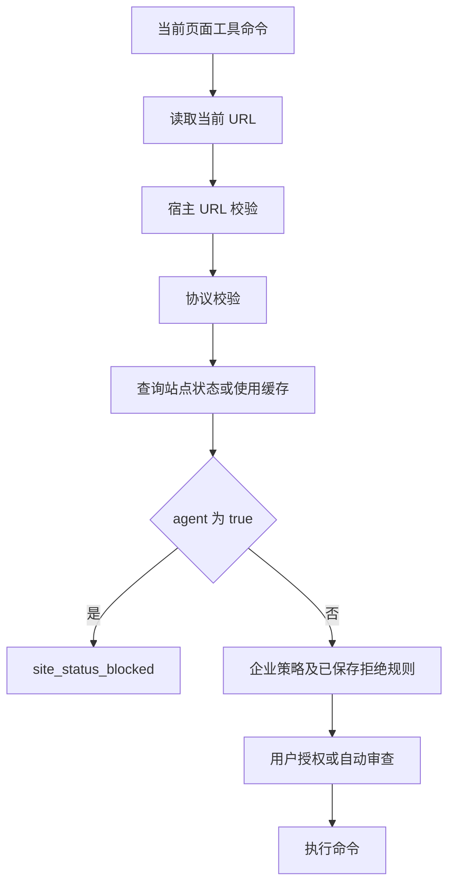

# Codex Desktop 浏览器网站限制：静态逆向分析

分析日期：2026-10-16。

结论：本机这个版本的浏览器工具包含独立的远端站点限制。插件向 OpenAI 的 `/aura/site_status` 查询站点状态；`feature_status.agent === true` 表示禁止 agent 访问，而不是启用 agent。命中后抛出 `BrowserUseSecurityError`，原因码为 `site_status_blocked`。此检查先于当前页面的用户授权，因此本地允许列表、`never_ask` 和 Full CDP 授权不能覆盖该结果。

本次没有发送远端策略请求，也没有读取个人会话、cookie 或认证文件。因此已经确认限制的实现，但没有确认 `taobao.com` 当前的服务端分类，也不能判断服务端为何限制某个网站。

## 分析对象

| 对象 | 本机证据 |
| --- | --- |
| Desktop 应用 | `/Applications/ChatGPT.app` |
| Bundle identifier | `com.openai.codex` |
| 应用版本 / build | `26.1007.71326` / `20398` |
| Chromium framework | `155.0.8059.40` |
| Browser 插件 | `~/.codex/plugins/cache/openai-bundled/browser/26.1007.71326/scripts/browser-service.mjs` |
| Desktop 归档 | `/Applications/ChatGPT.app/Contents/Resources/app.asar` |
| ASAR SHA-256 | `2f231a64e6dd30111bcd09e03c149cd06c8679b25914842772423251c4608ded` |

应用虽显示为 ChatGPT，仍使用 Codex 的 bundle identifier、框架及浏览器插件。以下结论针对这套本机版本；不应直接推广到所有历史 Codex Desktop 版本。

## 1. 远端站点策略是怎样判定的

插件第 999 行附近定义这些逻辑。压缩代码的原始行较长，精确字符偏移和原文见 [静态证据摘录](static-evidence.md) 与 [JSON 证据](static-evidence.json)。

- `W4 = "https://chatgpt.com/backend-api"`。
- `J4()` 构造 `/aura/site_status` 请求。
- `xS()` 解析 URL，并生成缓存键、展示用 URL 和请求地址。
- `vS()` 调用 `X4(response, "agent")`。
- `X4()` 仅在 `response.feature_status.agent === true` 时返回禁止。

请求结构如下，所有参数均由客户端 URL 编码：

```text
GET https://chatgpt.com/backend-api/aura/site_status
    ?site_url=<目标 URL>
    &url_request_source=codex_browser_use[:backend]
    [&conversation_id=<session_id>]
    [&turn_id=<turn_id>]
```

`site_url` 保留目标 URL 的 origin、path、query，不包含 fragment。请求可携带当前 conversation 和 turn 标识。策略查询经 `runtime.fetch()` 发送；仅凭这里的静态代码不能确定所有运行环境的认证传输细节。

插件第 1068 行附近的 `Zy.throwIfBlocksUrl()` 获取判定。命中禁止时抛出：

```text
BrowserUseSecurityError
reason: site_status_blocked
decisionSource: site_status
retryable: false
<Browser name> is not permitted on <display URL>.
```

对应错误说明明确写着：

> The site-safety policy blocks this action; no user permission prompt or Auto-review was attempted.

这说明该分支会在创建用户授权提示或 Auto-review 前结束。服务端响应中的 `agent: true` 是禁止标志，这一点容易看反。

## 2. 检查发生在什么时候

对需要访问当前页面的普通 tab 命令，`Qp.ensureCommandAllowed()` 先取当前 URL，再调用 `ensureUrlOriginAllowed()`。

下面展示这一路径；导航命令存在后文所述例外。



关键顺序来自：

```javascript
async ensureUrlOriginAllowed(url) {
  await this.ensureUrlPolicyAllowed(url);
  await this.ensureOriginConsentAllowed(qe(url));
}
```

`ensureUrlPolicyAllowed()` 按顺序调用可选的 `runtime.assertBrowserUrlAllowed`、协议校验 `JV()`、远端检查 `rk()`。本地允许规则在后面的 consent 路径发挥作用。

**导航入口是一个重要例外。** `navigate_tab_url` 被分类为 `targetUrl`，使用：

```javascript
async ensureTargetUrlOriginAllowed(url) {
  await this.ensureUrlPolicyAllowed(url, "browser-origin-access", false);
  await this.ensureOriginConsentAllowed(qe(url));
}
```

第三参数 `false` 关闭这一调用中的远端站点检查，宿主校验、协议校验及本地授权仍然执行。后续读取或操作当前页时，默认开启远端站点检查。

因此，这套实现允许出现“页面已经打开，但 agent 的读取、点击等后续操作被禁止”的现象。不能把它笼统描述成“禁止向该网站发送任何 HTTP 请求”。本次也没有找到所有重定向逐跳调用远端站点检查的证据。

跨 origin iframe 激活路径另有 `ensureUrlOriginAllowed(frame.url)`，因此部分 iframe 访问也会经过同一检查。

## 3. 缓存和失败行为

`Zy` 使用进程内 `Map`，有效期 `1440 * 60 * 1000`，即 24 小时。它同时缓存允许和禁止结果。

- 缓存键为小写 hostname，并移除开头的 `www.`。
- 缓存不包含 scheme、port、path、query、conversation 或 turn。
- 其他子域名保留独立缓存键，例如 `login.taobao.com` 与 `item.taobao.com`。
- 请求会发送完整的 origin、path、query，但结果按 hostname 缓存，查询粒度和缓存粒度不同。
- `isBlocked()` 每次先启动 `fetchBlocked()`；若已有有效缓存则直接返回旧结果，旁路请求的返回值在这条分支中不会写回缓存。不能理解为普通的“每次后台刷新缓存”。

没有有效缓存时，如果 fetch、HTTP 状态或 JSON 解析失败，`throwIfBlocksUrl()` 的 `catch { return }` 会放过这一道检查。若响应结构不符合预期，`X4()` 返回 `false`。后面的企业策略、用户拒绝规则和授权步骤仍然可能拒绝操作。

这是该版本的静态失败语义。本次没有修改网络、缓存或安全检查，也没有验证任何绕过方式。

## 4. 本地允许列表为什么不一定有用

本机 `~/.codex/browser/config.toml` 已有：

```toml
approval_mode = "never_ask"
full_cdp_access_enabled = true

[origins]
allowed = ["https://*.taobao.com", "https://*.1688.com"]
denied = []
```

这些配置控制用户授权及 Full CDP 能力，不代表远端站点策略允许。插件把 `site_status_blocked` 定义为独立的拒绝来源，且当前页面访问的站点检查先于 origin consent。

通配符还有一个细节：`https://*.taobao.com` 仅匹配子域名，不匹配 `https://taobao.com` 根域。`eC()` 将 `*.` 解析为 `subdomains-only`，`tC()` 只比较子域后缀；`**.` 才具有根域及子域语义。协议和端口也参与匹配。不过，本机同时设有 `never_ask`，所以缺少根域匹配本身仍不足以证明某次拒绝的原因。

此外，浏览器还读取企业强制策略：网络关闭、托管域名规则、默认或指定 origin 的 access/downloads/uploads/fullCdpAccess 规则等。该路径可抛出 `enterprise_policy_blocked`。本机是否存在生效中的企业策略，本次未读取账号或个人配置来确认。

插件内部将“跳过 consent”与“跳过 security checks”分为两套机制。普通的 `never_ask` 不等于跳过站点检查。静态代码还包含专用测试 security mode，本文不将其视作用户浏览器授权设置。

## 5. 另外三类限制不要混淆

| 层 | 证据与含义 |
| --- | --- |
| 插件协议限制 | `JV()` 检查导航 URL，拒绝时原因码为 `navigation_url_policy_blocked`。它与域名分类不同。 |
| Desktop 主进程导航限制 | `xie` / `Sie` 激活后调用 bootstrap 导出的 `lE()`。普通允许集合为 `http:`、`https:`、`about:blank`；另有内部条件分支和 subframe 例外。CDP 当前页与目标导航也会校验。相关报错为 `Blocked browser navigation by Browser Use URL policy: ...`。在这段代码中，HTTPS 淘宝 URL 不因域名被拒绝。 |
| 侧栏评论模式限制 | 主进程 `CR()` 也请求 `/aura/site_status?site_url=...` 并读取 `feature_status.agent`，控制 `commentModeDisabledReason`。它与浏览器插件的工具访问检查是两处独立调用。 |

Chrome 的 `ActorSafetyLists` 是另一份组件数据。本机 `9.8200.9609/listdata.json` 包含 2,144 条 `navigation_blocked` 和 20,751 条 `navigation_allowed`。其中 `taobao.com` 出现在 36 条允许的 origin 对中，禁止记录为 0。

这只能排除“本机这份列表直接把淘宝列为禁止导航条目”的解释。它不是全部安全机制的证明，也不能推断它允许淘宝上的所有 agent 操作。

## 6. 对 taobao.com 能确定到什么程度

已经确认：

1. 浏览器工具包含远端站点拒绝机制，具体端点、响应字段、异常类型和调用顺序都可从本机代码复核。
2. 本地用户配置已允许淘宝子域名，并开启 `never_ask`、Full CDP；这些设置不能覆盖已命中的 `site_status_blocked`。
3. 在所检查的 browser-service.mjs 中，没有 `taobao.com` 硬编码条目。
4. 主进程的基础协议允许集合不会单独拒绝合法的 HTTPS 淘宝地址。
5. 本机 ActorSafetyLists 没有淘宝禁止条目。

尚未确认：

- 淘宝任一具体 URL 当前是否返回 `feature_status.agent: true`。
- 先前实际拒绝是否来自 `site_status_blocked`、企业策略、用户规则或淘宝自身的验证码/访问拒绝。
- 服务端分类依据、名单来源、地区或账号差异。
- 是否还有宿主原生层或动态下发的附加策略。

若实际报错包含 `site_status_blocked` 或 `is not permitted on`，与本文定位的远端站点策略分支相符。若报错是 `enterprise_policy_blocked`、`navigation_url_policy_blocked`、`ERR_*`、HTTP 403 或 CAPTCHA，则需要按各自路径判断，不能仅凭“淘宝打不开”归因。

## 7. 产物与复核方法

- [原始摘录与哈希](static-evidence.md)：关键函数、原始行号与字符偏移。
- [结构化证据](static-evidence.json)：来源路径、SHA-256、关键片段及 ActorSafetyLists 统计。
- [ASAR 读取脚本](../scripts/inspect_asar.py)：仅解析归档索引和按路径抽取文本，不加载应用模块。
- [证据采集脚本](../scripts/collect_evidence.py)：按明确标记生成摘录并记录文件哈希。

ASAR 选定资产的副本位于 `evidence/asar-o8o1zl6s/`。它们是原始分析输入，未修改。脚本与提取目录分离，Python 使用 `-I` 隔离模式。

本次只做静态分析。没有执行插件代码，没有访问策略端点，没有更改已安装应用、浏览器设置或安全机制，没有提交或推送 Git 变更。
