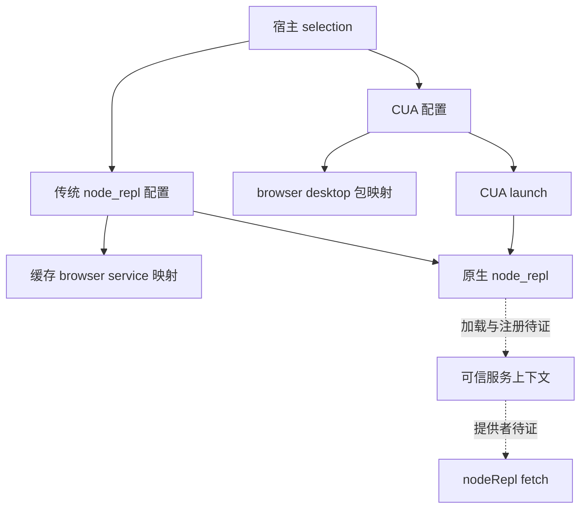

# 桌面宿主 runtime.fetch 入口调查

日期：2026-10-18。调查对象：用户明确授权的 `/Applications/ChatGPT.app`。

**已找到桌面宿主配置 browser 可信服务、选择运行时路径和构造 Node REPL 启动配置的位置；未找到已证实能替换服务所在上下文 fetch 的用户入口。可读脚本的执行链止于原生 `node_repl`，因此提前停止。**

当前应用的显示名称为 ChatGPT，bundle identifier 为 `com.openai.codex`；内部包名称为 `openai-codex-electron`、productName 为 Codex。应用版本 `26.1013.40934`，build `20770`。下文“宿主”仅指这份已核对身份的应用，不泛指其他 ChatGPT 或 Codex 安装。[P][PK]

本轮补上了前一报告缺失的**分发对应关系和宿主配置代码**：app 内 browser/chrome 的 service、client、manifest 与已授权缓存版本逐文件同字节。仍未证明正在运行的应用选择了哪条服务分支、实际加载了哪个模块，也未证明最终 HTTP 客户端或可注入时机。

## 授权、时间与方法

- 本轮依据用户 Q5 的明确同意及 `/Applications/ChatGPT.app` 精确目录访问授权；沿用 [ADR 0005](../docs/adr/0005-version-scoped-empirical-validation.md) 的限定版本、定向调查方向。
- 预算起点：2026-10-18T06:46:49Z；首次实际时间记录：06:47:16Z；硬截止：07:16:49Z。
- 核心宿主文件身份复核时间：06:53:17Z；最后定向源码核对发生在 06:57:27Z 时间记录之后；调查结束及报告交付记录：06:59:47Z。已定位原生二进制边界，提前停止，没有用满预算。
- 只读取 plist、manifest、包内脚本文本和必要目录清单；ASAR 作为数据读取。使用仓库现有 `scripts/inspect_asar.py`，以 Python `-I` 提取必要文件；只对源码字符串解析、检索和记录坐标，没有执行其中代码。
- 当前提取目录为 `/Users/pzehrel/Documents/repositories/my/codex-browser-liberation-patch/evidence/host-runtime-entry/asar-jr_a89ry/`。原建议 `.scratch/` 未被 Git 排除，因此改用已被 Git 排除、也不在 npm 发布白名单中的 `evidence/`。未修改 ignore 或发布配置。工件目录与解释器工作目录、自写命令分离。
- 未使用历史 ASAR 代替当前材料；未自动选择 `latest` 或其他版本。适用目录与归档清单中未发现额外 `AGENTS.md`/`CLAUDE.md`。

这是只读入口调查，不是实际生效验收。没有运行产品测试，也没有加载真实 bundle、执行应用二进制或请求站点状态接口。

## 应用与关键工件身份

除非另注，路径相对于 `/Applications/ChatGPT.app/`。摘要为文件全部字节的 SHA-256；版本声明、文件身份与运行状态分别记录。

| 代号 | 路径 | bytes | SHA-256 |
| --- | --- | ---: | --- |
| P | `Contents/Info.plist` | 20,738 | `8520b12f2bcf41fe7bb2d7d0fca7043ed495497c5a5405aafea01933f1b53058` |
| A | `Contents/Resources/app.asar` | 582,430,926 | `5ddc4e48259aa6f979e04529b1a5a4ae54b0f5c4ad6db5c6e004924c10916ddb` |
| R | `Contents/Resources/cua_node/manifest.json` | 482 | `b64afbf6eda206e63d1fb0367d6f450fd7d153ef4becdd793c483378e3492974` |
| NR | `Contents/Resources/cua_node/bin/node_repl` | 19,255,584 | `190b225f83ee6a3e1c4ca532bbf2178ddf21747d113c706b8dfcfcd33f5db0f0` |
| N | `Contents/Resources/cua_node/bin/node` | 122,127,712 | `5cdbcfcbbae201df8af79027fed814f4b379c55a00f4a20c9bcafb3d2f7cf47f` |

P 声明 `CFBundleName`/`CFBundleDisplayName` 为 ChatGPT，`CFBundleIdentifier` 为 `com.openai.codex`，`CFBundleShortVersionString` 为 `26.1013.40934`，`CFBundleVersion` 为 `20770`，`CFBundleExecutable` 为 ChatGPT，最低系统版本为 `13.0`。四个复核核心文件 P/A/R/NR 的实际路径与规范路径一致，复核摘要与首次读取一致。

P 的 `ElectronAsarIntegrity` 另声明 `Resources/app.asar` 的 SHA256 值 `b276579474c7f0413ae388aaf39d00337f7615a858774156f1268c68519ebab1`。它与上表全文件摘要的测量对象不能混用；本轮没有验证 Electron 的完整性校验过程，不据两值不同推断篡改。

A 的清单包含 21,174 项。以下文件从这份当前归档提取，路径相对于上述新空提取目录：

| 代号 | 归档内路径 | bytes | SHA-256 |
| --- | --- | ---: | --- |
| M | `.vite/build/main-CLu1A25j.js` | 4,049,636 | `8aedee047ec0a078e65b24dc917c64ad544220395e773feb6740f4447008a495` |
| S | `.vite/build/src-Dtwb7yKT.js` | 205,866 | `a0e4b4b014f04a9391bcfa6a0d6f2b6703590daacf3591831a62fec809b2cb76` |
| L | `.vite/build/application-network-startup-DB1VeU3v.js` | 292,827 | `c338bbdde151467554d63beea59206848ca38a68abe16b0477d983a172c67578` |
| X | `.vite/build/src-DsLVGakC.js` | 1,608,479 | `28a0918f01c50b0eb17676e894998ad7182f119d978adf0467ccaac3583f259c` |
| PK | `package.json` | 5,764 | `a9c706de86e7cf9399c5f67f9232df8f4ee8732edffcf86f9f9bc5d037c4b460` |

PK 第 2–7 行声明内部名称、版本和 `.vite/build/early-bootstrap.js` 入口；第 116–118 行声明 prod、build `20770` 和 Codex 更新源。第 57 行的 Electron `42.3.0` 是依赖声明，本轮没有执行宿主确认运行中的 Electron 版本。[PK]

R 声明 darwin/arm64、Node binary version `24.21.0`、runtime archive version `0.0.30/20261014203459-0849368674e2`，并将 node、node_modules、node_repl 分别定位到 `bin/node`、`lib/node_modules`、`bin/node_repl`。没有运行 `--version`。[R，第 2–12 行]

## 与缓存插件的对应关系

app 的实际插件根目录是：

`/Applications/ChatGPT.app/Contents/Resources/plugins/openai-bundled/plugins/`

其上一级 `.bundle-id` 为 `0dcbc95e-d969-4cf0-b27d-0699360df581`。下面文件与 `/Users/pzehrel/.codex/plugins/cache/openai-bundled/{browser,chrome}/26.1013.40934/` 的对应文件全部同字节：

| 文件 | bytes | app 与缓存共同的 SHA-256 |
| --- | ---: | --- |
| browser/chrome `scripts/browser-service.mjs`，四份相同 | 1,462,840 | `c470cdc7f98be2724ef1c85f6b9d3757d80de022b065ca14d922d7a1a85ffc9a` |
| browser/chrome `scripts/browser-client.mjs`，四份相同 | 169,663 | `78f5a38ab02f23b68e4650e3bfe9ec2f269c5e004f30a1f59eee927a221a2e2f` |
| browser `.codex-plugin/plugin.json` | 3,432 | `188f075c18e33ff9ac5ea55bc5ac463ff385cbdf283b8afd5a45015586c8859f` |
| chrome `.codex-plugin/plugin.json` | 3,303 | `4c985d7ed75fdffab590c59fa1da639595381a1c9327a4b9cd9d09e003eb8656` |

两 manifest 的 name/version 分别为 browser、chrome 和 `26.1013.40934`。因此[上一轮报告](runtime-fetch-entry-26.1013.40934.zh-CN.md)中的插件内部坐标可用于这些相同字节的 app 捆绑文件。

**这里证明的是分发工件对应。** 没有读取活跃用户配置、检查运行进程或观察实际 import，不能由同版本、同哈希推出当前使用缓存 service；下一节还存在不同的 CUA 服务映射分支。

## 宿主配置、服务加载与 RPC 边界

以下源码坐标均为**零基 UTF-16 半开区间**，行号为一基。引用必须与上表文件身份一起复核。报告不复制专有源码。

### 运行时路径及环境覆盖

M 的 `Ui` 位于第 8 行、`[90721,92195)`；后接 `Wi` `[92195,92458)`、`Gi` `[92458,92739)`。[M]

`Ui` 默认读取 `process.env`，为 Codex CLI、Node 和 Node REPL 分别解析运行时路径。其静态逻辑优先接受非空环境覆盖，否则走 bundled/dev resolver：

| 环境名称 | 影响的路径 | 本轮证据的限度 |
| --- | --- | --- |
| `CODEX_NODE_REPL_PATH` | Node REPL 可执行路径 | 具体的可执行路径候选控制面；不是现成 JS preload 接口。 |
| `CODEX_BROWSER_USE_NODE_PATH` | 交给 REPL 配置的 Node 路径 | 不能据此证明 Node 加载代码的时机或服务所在 realm。 |
| `CODEX_CLI_PATH` | Codex CLI 可执行路径 | 不是站点状态 fetch 的直接包装参数。 |

L 第 4 行的 `We` `[15855,16021)`、`Ge` `[16021,16172)` 和 `Ke` `[16172,16423)` 分别解析 node_repl、node 和 Node 模块目录。`Ze` `[17882,18568)` 组合运行时根目录和 bin 下的可执行文件；`nt` 从 `[20498,…)` 开始，选择资源根下的 `cua_node` 并检查目录。R 则提供当前安装中实际存在的相对路径。[L][R]

这些静态入口比“未见任何宿主入口”更具体，但本轮没有设置变量、启动 GUI 或观察实际值。GUI 是否继承所需环境、启动链是否保留变量、替换可执行路径是否能在**可信服务上下文创建前**介入，均未验证。不能把这三个名称等同于可用的 `NODE_OPTIONS` 或 `--import` 注入方案。

### 传统 browser 服务配置

M 第 32 行、UTF-16 起点 `157546` 的 selection 字段从已安装插件取得 `browserServicePluginVersion`，缺失时为 null；不是无条件采用 appVersion。

M 第 33 行的 async `Hs` `[173153,174504)` 接收 selection 与 runtimePaths，再调用 `zre` `[174504,176811)`。后者执行下列配置工作：

1. 要求 nodeReplPath、nodePath 存在。
2. 在有 browser backend 时，以 `browserServicePluginVersion ?? appVersion` 构造插件缓存根，再拼接 `scripts/browser-service.mjs`。
3. 把 `browser` 服务名到该路径的映射编码到 `NODE_REPL_TRUSTED_SERVICES`；按条件同时加入 Sky 服务。
4. 调共享配置构造器，生成 Node REPL 的 MCP 启动配置。[M]

路径 helper 是 S 第 52 行、UTF-16 起点 `114604` 的 `du`，构造 `codexHome/plugins/cache/marketplace/plugin/version`。M 使用的导出名 `Kt` 对应此函数；S 中另一个内部同名 `Kt` 是不同功能，不能按压缩名称混淆。

M 的 `i.fs` 对应 S 的 `NODE_REPL_TRUSTED_SERVICES` 常量；`i.ps` 对应 S 的 `E`。S 采用 CommonJS `Object.defineProperty` getter 导出，相关导出在第 57 行；不是 ES export declaration。

S 第 1 行的 `E` `[6865,7615)` 生成 `mcp_servers.node_repl` 配置：command 为 nodeReplPath，args 为空，启动超时 120 秒；env 包含 Node 路径、模块目录、可信代码路径、CODEX_HOME 和调用者 extraEnv，可另带 env_vars。[S]

**这证明了宿主如何声明可信服务和构造启动配置。** 实际 MCP 子进程启动、模块导入、`browser` RPC 注册与请求分派，不能由这段配置构造代码直接视为已经发生。现有可读链在这里转向 NR。

### CUA 服务分支需要单独处理

M 第 20 行的 `Aa` 从 UTF-16 `101126` 开始。它把已有 Node REPL 配置转换为 `cua_repl` 配置：以 Node 启动 `@oai/cua-repl/bin/cua-repl.mjs`，将原 command 放进 `CUA_REPL_NODE_REPL_PATH`；browser 服务映射改为 `@oai/browser-desktop/service`，computer 映射为 `@oai/sky/service`。[M]

因此，不能假设当前每次 browser 请求都走传统缓存 `browser-service.mjs`。本轮没有观察 feature selection 或活跃配置，未确定当前实际采用传统 node_repl 还是 CUA 分支，也没有继续展开 `@oai/browser-desktop/service` 的内部实现。

包内 `@oai/cua-repl` 的 version 为 `0.1.0`。其 bin 文件只把调用转给 launch；launch 要求 `CUA_REPL_NODE_REPL_PATH` 是绝对可执行路径，读取 enabled surfaces，再以空参数、继承 stdio 和组合后的环境 spawn 此路径。调用者已经提供 `NODE_REPL_TRUSTED_SERVICES` 时，launch 保留它，否则设置默认服务映射。[CL，第 1 行]

这条可读 wrapper 同样止于 NR，没有给出 `nodeRepl.fetch` 实现。旁边 `.mcp.template.json` 声明 `cua_repl`、默认 disabled、startup timeout 120；模板不代表活跃配置。[CT]

下图区分已见配置分支与尚未补齐的原生实现边界；箭头表示静态配置/调用关系，不表示已经观察到运行。

### 插件侧已知链与尚缺的实现

对于已核对同字节的缓存/app 捆绑 service，前一轮已定位以下关系：

| 环节 | 直接证据 | 当前结论 |
| --- | --- | --- |
| client 发出 browser RPC | client 第 9 行 `XC` `[168414,169628)` | 调用所在上下文的 `globalThis.nodeRepl.rpc`；不证明它与服务同 realm。 |
| service 导出 RPC 入口 | service 第 4481 行 `eQe` `[1462538,1462722)` | 按方法表调用 setup/execute 等；实际宿主导入和注册未见。 |
| 插件局部 runtime 创建 | service 第 4481 行 `A3` `[1460344,1460820)`、`Aae` `[1461026,1461354)` | 读取服务上下文的 nodeRepl，复制可枚举自有属性并补能力。 |
| 读取宿主对象 | service 第 4457 行 `n2` `[1336314,1336386)` | 对象由宿主预先提供；创建者仍未定位。 |
| 调用目标 fetch | service 运输包装 `ok` `[612073,612280)`，调用点 `[612267,612279)` | 使用传入 runtime 的 fetch，并保留 receiver。 |
| 最终 HTTP 实现/网络栈 | 可读链止于 NR | 未证明是 Node fetch、Rust/IPC、Electron 或其他实现。 |

NR 是 Mach-O 二进制，已经记录身份；没有运行、反汇编、扫描 strings 或扩大到其他二进制。准确边界是“已读脚本转交原生 REPL，未获得内部实现证据”，不能据文件类型推断其具体语言、内嵌引擎或 fetch 网络栈。

## realm、时机与可写性

| 问题 | 静态观察 | 仍未验证 |
| --- | --- | --- |
| 用户 JS 是否与可信 browser service 同 realm | client 通过 RPC，service 读取自身 globalThis；宿主配置存在 trusted service 映射。 | 隔离方式、共享对象、用户代码能看到的 nodeRepl 与服务 nodeRepl 是否相同。 |
| fetch 的创建与捕获时机 | service Aae 用展开复制宿主对象，之后将 runtime 传到站点状态链。 | 原生创建时机、首次服务 import/setup 时机、是否已缓存函数。 |
| fetch 是否可写 | 插件构造未提供显式 fetch 注入参数。 | 对象是否冻结、fetch 的属性描述符、getter 或代理行为、写入是否影响实际调用。 |
| 修改源 nodeRepl.fetch 是否影响既有 runtime | 复制发生在插件 setup 路径。 | 已复制的函数不会因为源属性重新赋值而必然改变；还需确定是否控制复制前时机。 |
| 环境路径覆盖是否可用 | 宿主 resolver 接受具体 CODEX_* 环境名称。 | GUI 环境继承、实际分支、可执行文件约束、能否进入服务 realm。 |
| Node REPL 环境快照是否说明 fetch 冻结 | CUA README 描述 frozen nodeRepl.env snapshot。 | env 快照描述不能证明整个 nodeRepl 或 fetch 的冻结与可写性。 |

普通 Node 的 preload 机制、网页 `window.fetch` 或浏览器 CDP 网络拦截都不能补足这些本地事实。本轮没有把已有官方通用文档重复研究成入口证据。

## 最小下一步与停止条件

**本轮停止于原生 Node REPL 边界，没有发现已证实可用的同上下文 fetch 包装入口。** 已满足本轮“若只定位到二进制边界就报告，不为用满时间通用扫描”的停止条件。

若后续按 ADR 0005 继续，最小待解决问题是：先确认目标版本实际采用哪条服务分支及加载工件，再取得该分支可信服务上下文的 fetch 属性、来源和初始化时机证据。未确定活跃分支前，不应制作针对缓存 service 的 wrapper 并宣称可用。

可以由后续明确授权的限定实验获得这些信息；不必恢复完整静态证明。实验授权应具体包含可否启动目标宿主、可否使用指定运行时路径覆盖、可否加载诊断代码及如何撤销。当前仅有只读授权，这些动作本轮均未实施。即使路径覆盖被接受，也需分别验证它能影响目标 fetch、字段修改确实生效、缓存不掩盖结果、撤销后恢复原行为，且保留用户拒绝、企业策略和其他权限限制。

若继续只读，则需要与 NR 精确身份对应的原生提供者源码或调试资料，才能直接追踪服务加载、RPC 注册和 fetch 创建；现有脚本文本不足以回答。没有这些材料时应保留阻断，不自动扩大到二进制逆向、全盘搜索或更换样本。

本报告未实现 wrapper、原型或拦截。没有执行/import 真实 bundle，执行/编译/实例化 Wasm，启动/重启/终止应用，连接调试口，抓流量，请求状态接口或加载自定义代码；没有修改安装、用户配置、代理、证书、分析器、tracker、commit、push 或 PR。新增材料仅为本报告及已排除目录中的必要归档提取文件。

## 本地来源索引

- **[P]** [当前应用 Info.plist](/Applications/ChatGPT.app/Contents/Info.plist)。
- **[A]** [当前 app.asar](/Applications/ChatGPT.app/Contents/Resources/app.asar)，读取工具为 [inspect_asar.py](../scripts/inspect_asar.py)。
- **[PK]** [当前归档 package.json](../evidence/host-runtime-entry/asar-jr_a89ry/package.json:1)。
- **[M]** [当前归档 main](../evidence/host-runtime-entry/asar-jr_a89ry/.vite/build/main-CLu1A25j.js:33)，另见第 8、20、32 行。
- **[S]** [当前归档共享配置模块](../evidence/host-runtime-entry/asar-jr_a89ry/.vite/build/src-Dtwb7yKT.js:1)，另见第 52、57 行。
- **[L]** [当前归档运行时路径 resolver](../evidence/host-runtime-entry/asar-jr_a89ry/.vite/build/application-network-startup-DB1VeU3v.js:4)。
- **[R]** [当前运行时 manifest](/Applications/ChatGPT.app/Contents/Resources/cua_node/manifest.json:1)。
- **[NR]** `/Applications/ChatGPT.app/Contents/Resources/cua_node/bin/node_repl`，只记录身份与文件类型。
- **[CL]** [CUA launch](/Applications/ChatGPT.app/Contents/Resources/cua_node/lib/node_modules/@oai/cua-repl/dist/lib/js/oai_js_cua_repl/src/launch.js:1)，2,037 bytes，SHA-256 `3e52a41f4da41d35be8cc3723fe97251711087a998c1ed7f2cfdf7e20b50fc2b`。
- **[CT]** [CUA MCP 模板](/Applications/ChatGPT.app/Contents/Resources/cua_node/lib/node_modules/@oai/cua-repl/plugin/.mcp.template.json:1)，349 bytes，SHA-256 `e7297a8851d46bb5d7f53d57e82d86cfdf4b04524bedf8c2ce6cf4a80ffe71da`。
- [前一轮插件入口调查与身份、坐标](runtime-fetch-entry-26.1013.40934.zh-CN.md)。

报告只保留身份、坐标和行为概述；提取的专有源码留在 Git/npm 排除目录。上述本地链接用于本机复核，不意味着源码进入发布包。
